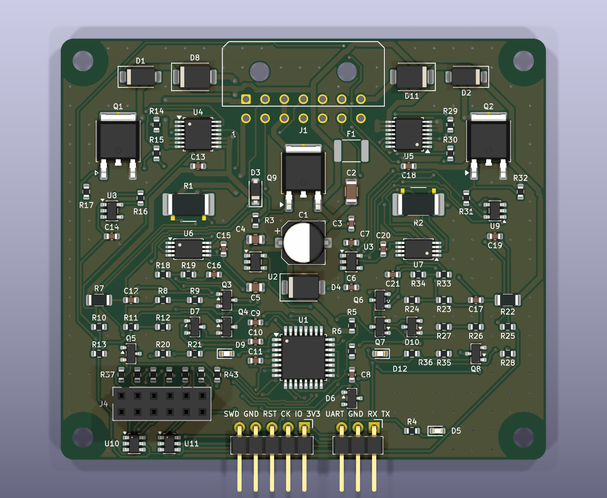

# Contactor Economizer

A two-channel 12 V economizer board for high-voltage contactor coils, built for an EV conversion using
salvaged contactors.

When the vehicle controller commands a contactor closed, the board pulls it in with a strong,
current-regulated pulse and then holds it at a much lower current. For a Gigavac GV200-005 that cuts the
12 V load from about 28 W to under 1 W per contactor, and the coil runs cool.

**Status:** revision B. The design is complete and the files are ready for JLCPCB, but no board has
been built or tested yet.

## Documentation

- **[Operator's manual](OPERATORS_MANUAL.md)** covers fitting the connectors, wiring, programming, setup,
  bench testing, installation, fault codes and serial commands.
- [Design notes](handoff.md) record the design decisions, calculations, reviews and open items.

## Features

- Two independent channels, commanded directly by the VCU's existing low-side contactor outputs. No VCU
  firmware change is needed.
- Pick-up and hold currents are both regulated, so one board suits coils from 0.5 to 100 Ω.
- Built-in presets for the Gigavac GV200-005, LS Electric GER150 and Panasonic AEV14012. Custom
  settings are entered over a serial port.
- Fail-safe:
  - Only the VCU command can switch a coil on; the microcontroller can only force it off.
  - With no firmware running, the contactors stay open.
- Fast release from a hardware clamp, reverse-polarity protection, and an open-drain status output per
  channel.
- STM32G031 microcontroller, TI TPS1H100-Q1 smart high-side switches, and INA240 current sensing.
- Optional stacking socket for an insulation monitor (IMD) board. The IMD can block a contactor from
  closing but never forces one open. Without an IMD, the board works stand-alone.
- 76 × 66 mm, 2-layer board.

## Repository layout

| Path | Contents |
|---|---|
| `src/main.cpp`, `platformio.ini` | Firmware (PlatformIO, STM32duino) |
| `hw/econ.kicad_pro` | KiCad 10 project: open this to view the schematic and board |
| `hw/econ_schematic.pdf` | Schematic as a PDF |
| `hw/fab/` | JLCPCB order files: Gerber zip, BOM, placement file, 3D renders |
| `hw/design.py` | Parts and connections. The schematic and board are generated from this file. |
| `hw/gen_*.py`, `hw/fab.py` | Generator scripts (see the design notes for the pipeline) |

The schematic and board are generated from `hw/design.py`. Change that file and regenerate, rather
than editing the KiCad files by hand.

## Building the firmware

Open the repository in VS Code with the PlatformIO extension and click **Build**, or run `pio run`.
Flashing and setup are covered in the [operator's manual](OPERATORS_MANUAL.md#5-programming-the-board).

## License

[MIT](LICENSE): this covers the firmware, the hardware design files and the documentation. The board
switches circuits on high-voltage systems. Build and use it at your own risk; the license provides no
warranty.
